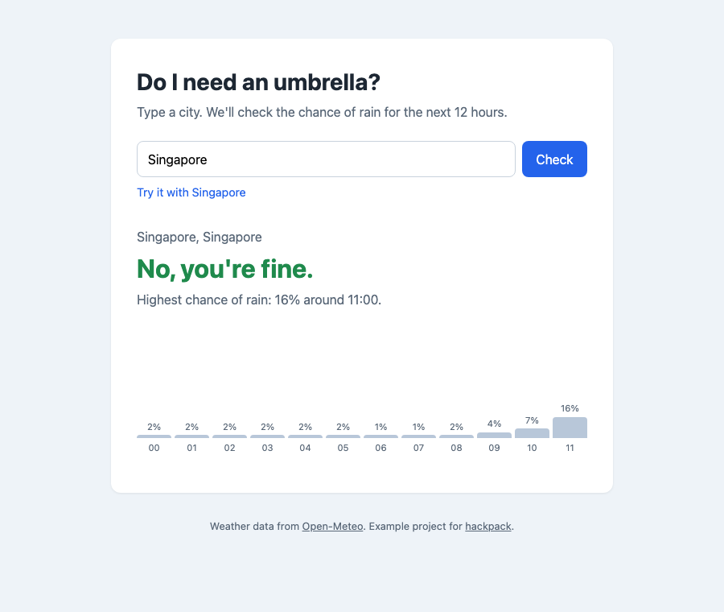

# rain-check

Type a city, find out whether you need an umbrella in the next 12 hours.

> **This is an example project.** It was made for [hackpack](https://jay-jay-tee.github.io/hackpack/) to show what a good hackathon repo and submission look like. It wasn't entered in a real hackathon. Have a look around: the README, the commit history, the [pull request](https://github.com/Jay-Jay-Tee/rain-check/pulls?q=is%3Apr), the [issues](https://github.com/Jay-Jay-Tee/rain-check/issues), `AGENTS.md` and the `.claude/skills/` folder are all part of the example.



[**Live demo**](https://jay-jay-tee.github.io/rain-check/) · [Try it with London](https://jay-jay-tee.github.io/rain-check/?city=London)

## The problem

Weather apps show a lot of information when most mornings you only want to know one thing before leaving: do I take an umbrella or not?

## What it does

- Search any city.
- Get a plain yes or no, based on whether the chance of rain goes above 50% in the next 12 hours.
- See the chance of rain for each hour, with the risky hours highlighted.
- Remembers the last city you checked.

## How it works

```
[ browser ] ──city name──▶ [ Open-Meteo geocoding ] ──lat/lon──▶ [ Open-Meteo forecast ]
     ▲                                                                    │
     └──────────────── hourly chance of rain ─────────────────────────────┘
```

- **Frontend:** plain HTML, CSS and JavaScript. No framework or build step.
- **Data:** [Open-Meteo](https://open-meteo.com/) geocoding and forecast APIs. Free, no API key.
- **Hosting:** GitHub Pages, deployed from `main`.
- **Fallback:** if the weather service fails, the app shows saved sample data from `demo-data.js` and says so, so a live demo can't break.

## Running it locally

No install needed.

```bash
git clone https://github.com/Jay-Jay-Tee/rain-check.git
cd rain-check
python3 -m http.server
```

Then open <http://localhost:8000>. Add `?city=Tokyo` to the URL to search straight away.

### Environment variables

None. Open-Meteo doesn't need a key, so there's no `.env`. If your project does use keys, commit a `.env.example` with the variable names and keep the real `.env` out of git.

## What's mocked

- Nothing in normal use. `demo-data.js` is only used when the API can't be reached, and the page shows a note when that happens.

## Not built

- Using your current location instead of typing a city ([issue #1](https://github.com/Jay-Jay-Tee/rain-check/issues/1))
- Notifications in the morning
- Choosing your own rain threshold

## Next steps

- [ ] Use the browser's location
- [ ] Let people set their own threshold (some people don't mind a bit of rain)
- [ ] Show temperature alongside rain

## Team

- [@Jay-Jay-Tee](https://github.com/Jay-Jay-Tee): everything (it's a small example)

## Built for

[hackpack](https://github.com/Jay-Jay-Tee/hackpack), as a reference project. MIT licensed.
